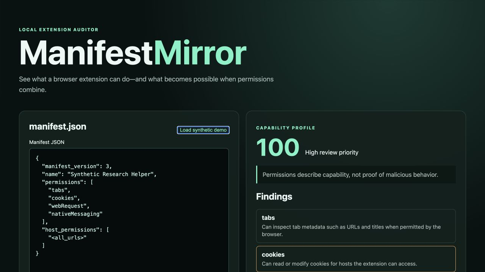

# ManifestMirror

ManifestMirror is a local browser-extension permission auditor. It reads a
`manifest.json` and explains capabilities, broad host access, and dangerous
permission combinations. It never installs or runs the extension.

Its main idea is **combination risk**: `cookies`, `<all_urls>`, and a native
bridge together deserve more review than a checklist of three isolated words.

Open `index.html` in a modern browser or run `npm test` with Node 20+.

Scores prioritize human review; they do not label an extension malicious.
Permissions can support legitimate features, and actual behavior requires code
review and controlled testing.

## AI-assisted authorship

OpenAI Codex generated the initial implementation, tests, interface, and
documentation. The owner must review and understand it before describing a
personal contribution.
